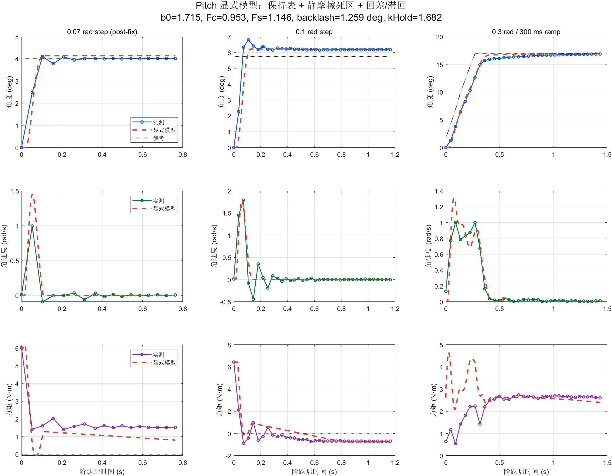

# Pitch 最终模型：显式静摩擦、回差和位置保持力矩

最终模型不再用单一 `k*theta` 近似整段行程，而是显式包含：

- 全行程静态标定得到的 `H(theta)` 位置保持力矩；
- 静摩擦粘滞/起动阈值 `Fs`；
- 动能摩擦 `Fc`；
- 保持位置的回差/滞回宽度 `bH`；
- 执行器一阶滞后和纯延迟。

## 1. 模型

```text
J*w' = tauA - kHold*(H(thetaH)-H(theta0))
       - b0*w - Fc*tanh(w/wS)
```

当速度接近零且

```text
abs(tauA - kHold*(H(thetaH)-H(theta0))) <= Fs
```

时进入粘滞状态，速度和位置保持不变；超过起动阈值后才转为滑动摩擦。

`thetaH` 是带回差的保持位置：

```text
thetaH 跟随 theta，但保留宽度为 bH 的死区
```

这样同一个实测角在加载和卸载方向可以对应不同的保持力矩，避免普通 `k*theta` 把回差和静摩擦都混进弹簧刚度。

## 2. 静态标定表

使用 9 N·m 全行程静态标定的 19 个有效点：

```text
覆盖 -0.2508 ~ +0.6177 rad
```

原始表在 0.18~0.23 rad 附近存在由静摩擦/测量造成的非单调凹坑。直接做样条会出现局部负刚度，因此先对保持力矩做单调化处理，再进行 PCHIP 插值。

原始点、单调化结果和用于仿真的表保存在：

- `data/pitch_hold_table_261019.csv`
- `data/emberprobe-live-20261019-214452.csv`

## 3. 拟合参数

固定开环扫频得到的：

```text
J       = 0.07008 kg*m^2
Td      = 16.25 ms
tau_act = 5.45 ms
```

显式拟合参数：

```text
b0      = 1.71536 N*m*s/rad
Fc      = 0.95263 N*m
Fs      = 1.14636 N*m
wS      = 0.00200 rad/s
bH      = 0.02197 rad = 1.259 deg
kHold   = 1.68235
```

控制器和固件一致：

```text
Kpa             = 15
Kpw             = 3
Kiw             = 20 /s
pitch_ff_tau_c  = 0.94 N*m
pitch_ff_w_lin  = 0.30 rad/s
kFF             = 25 N*m/rad
pitch_ff_max    = 2.0 N*m
速度环输出限幅  3.5 N*m
速度环积分限幅  2.0 N*m
角度环速度限幅  3.0 rad/s
```

## 4. 三组工况结果

| 工况 | 角度 NRMSE | 角速度 NRMSE | 力矩 NRMSE |
| --- | ---: | ---: | ---: |
| 0.07 rad 阶跃 | 5.7% | 11.9% | 9.6% |
| 0.1 rad 瞬时阶跃 | 7.6% | 8.4% | 10.4% |
| 0.3 rad / 300 ms 斜坡 | 2.2% | 7.1% | 33.0% |

相比只用 `kLow/kHigh` 的混合模型，0.07 和 0.1 的力矩误差从约 23~25% 降到约 10%；静摩擦死区和保持表是主要改善来源。



## 5. 为什么单次 0.07 rad 拟合率能到 1.52%

`pitch_step_fit_261019.png` 使用的是单独针对修复后 0.07 rad 阶跃的闭环拟合：

```text
J=0.09389, b0=1.5793, tau_c=0.05, k=51.73, theta0=0.3346
```

角度 NRMSE 为 1.52%，原因是：

1. 该拟合只优化这一条角度曲线，五个植物参数同时自由变化；
2. 控制器、摩擦前馈和刚度前馈固定，植物参数可以吸收闭环结构失配；
3. CSV 只有 17 个点，采样间隔约 45 ms；
4. 没有用 0.1/0.3 rad 或开环扫频数据做留一验证；
5. 角度拟合好不代表速度和力矩同样好：该图模型速度峰值约 1.4 rad/s、实测约 1.0 rad/s，模型峰值力矩约 5.08 N·m、实测约 6.02 N·m。

因此 1.52% 是单次、单工作点、稀疏采样下的自拟合误差，不是最终模型的泛化精度。

## 6. 复现

```matlab
addpath('pitch-axis/matlab');
pitch_explicit_hold_friction_backlash_261019
```

脚本读取 `pitch-axis/data/`，输出到 `pitch-axis/generated/`。
