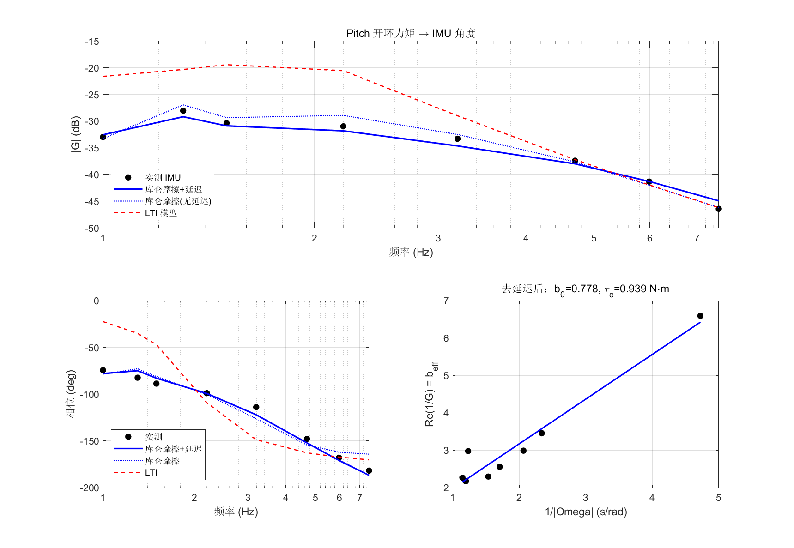
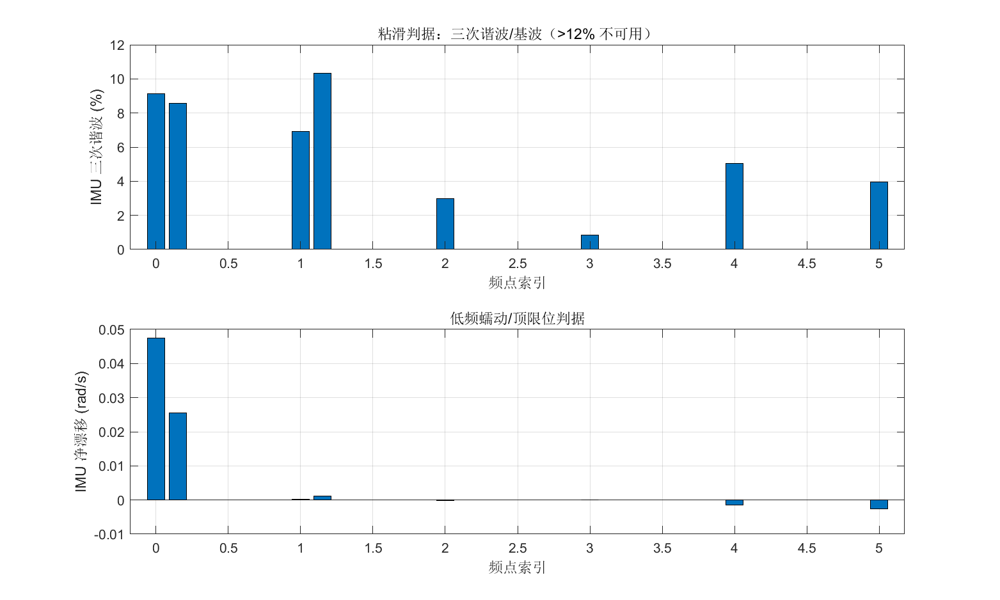
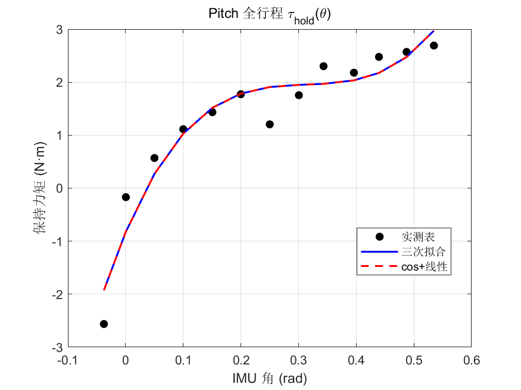
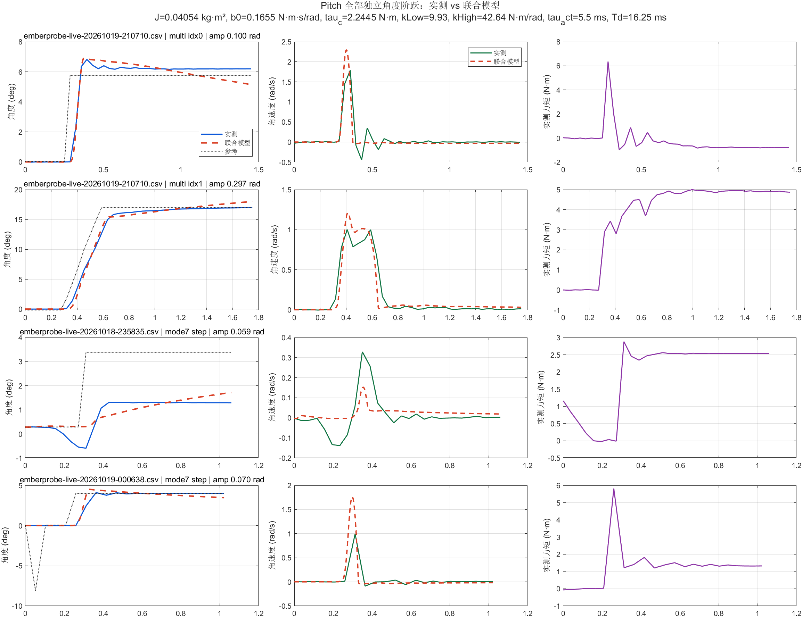
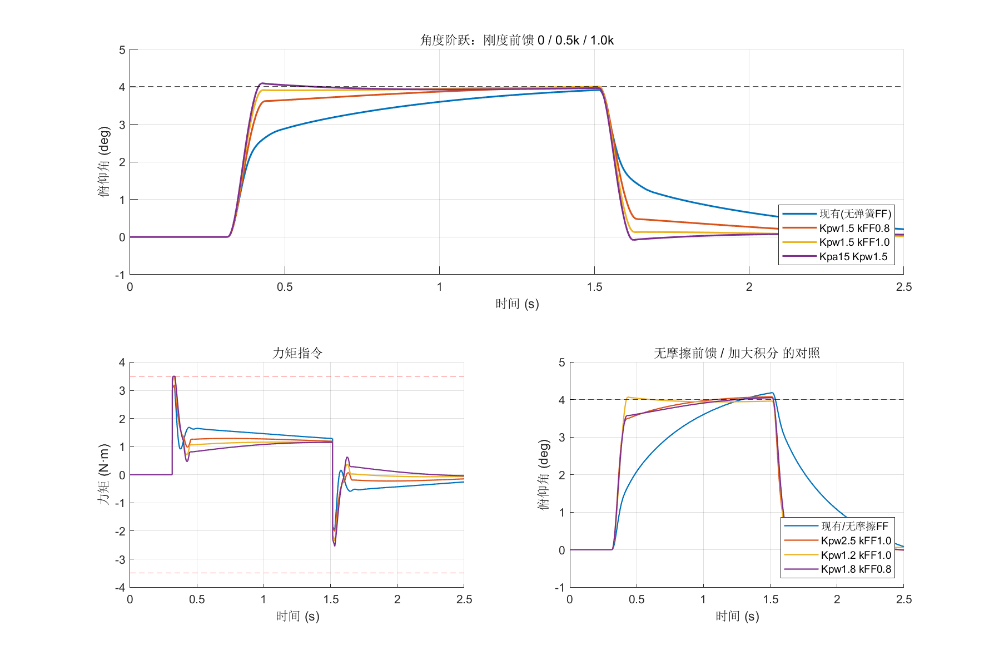
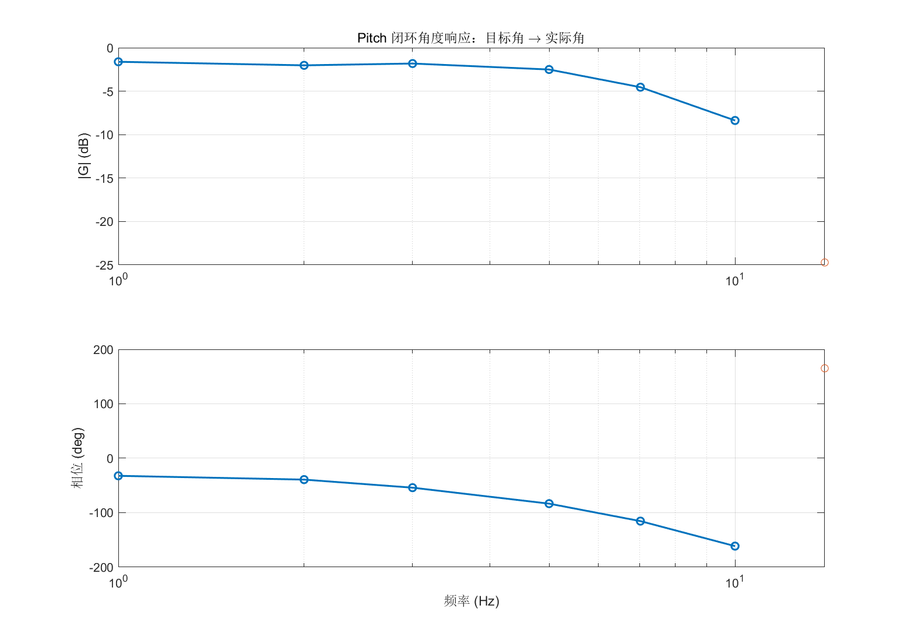

# Pitch 轴系统辨识与串级 PID 整定

本目录记录 RoboMaster 云台 Pitch 轴从开环辨识、静态全行程标定、角度阶跃联合拟合，到摩擦/位置前馈和实机验证的完整流程。数据、MATLAB 脚本和结果图都放在本目录内，可以直接复现。

详细历史记录见 [IDENTIFICATION_REPORT.md](IDENTIFICATION_REPORT.md)。

## 1. 轴与约束

本工程 Pitch 轴为 1:1 传动，角度取自 IMU 空间：

```text
GIMBAL_PITCH_MIN = -0.334367 rad
GIMBAL_PITCH_MAX = +0.645449 rad
总行程            = 0.979816 rad
```

DM4310 额定力矩约 3 N·m，峰值约 7 N·m。9 N·m 只用于短时静态标定，不作为正常工作限幅。

Pitch 与 Yaw 的关键区别：

- 行程只有约 0.98 rad，低频开环正弦会把轴推到限位；
- 有机械重力补偿，但仍有明显非线性弹簧、静摩擦和粘滑；
- 回中到位后可能出现约 −1.9 N·m 的保持力矩偏置，而轴不动，说明存在静摩擦死区；
- 工作点附近的等效刚度会随位置变化，不能用一套线性刚度覆盖全行程。

## 2. 工作点选择

### 2.1 0.15 rad：多幅值验证工作点

使用 `pitch_multi_center=0.15 rad`，跑：

- 0.1 rad 瞬时角度阶跃；
- 0.3 rad / 300 ms 斜坡；
- 每段后回中。

选择原因：

- 位于可用行程中部，正负摆幅都有余量；
- 可观察 0.1 rad 小信号和 0.3 rad 大信号在工作点附近的线性度；
- 0.3 rad 斜坡不直接撞机械限位，但仍能检验速度和力矩。

### 2.2 0.30 rad：开环扫频与 0.07 rad 阶跃工作点

开环扫频和 0.07 rad 角度阶跃主要在 `0.30 rad` 附近进行。

选择原因：

- 远离正端 `+0.645 rad`，低频摆动仍有余量；
- 弹簧/重力负载接近常用瞄准区，动态特性有代表性；
- 0.07 rad 阶跃幅值足够大于编码器量化，又不会让速度环长时间顶到 3.5 N·m。

### 2.3 全行程静态标定点

全行程静态标定使用：

```text
pitch_full_start = GIMBAL_PITCH_MIN + 0.01 = -0.32437 rad
pitch_full_end   = GIMBAL_PITCH_MAX - 0.01 = +0.63545 rad
pitch_full_step  = 0.05 rad
目标点数          = 20
```

标定点覆盖 `-0.3244 ~ +0.6256 rad`。流程为每点 300 ms 斜坡、1500 ms 稳定、300 ms 平均。标定期间关闭摩擦/位置前馈，只测纯保持力矩。

负端没有完全到达：

- 目标 `-0.3244 rad`，9 N·m 下实际停在约 `-0.2649 rad`；
- 第一张有效表点从 `-0.2508 rad` 开始，保持力矩约 `-5.06 N·m`；
- 峰值力矩达到 9.0 N·m，说明限制来自机械下限/弹簧负载，不是控制限幅；
- 不应继续增加标定力矩，应检查弹簧预紧、线束和机械限位。

## 3. 辨识流程

### 3.1 开环力矩正弦扫频：动态参数

固件使用 `sys_id_method=1` 和 `force_sys_id_axis=2` 进入 Pitch 开环力矩扫频。该模式是纯开环：

```text
Gimbal.pitch.torque_out = 正弦力矩 + 可选重力补偿
```

不叠加 `Pitch_Friction_FF()`，也不叠加 `Pitch_Spring_FF()`。内部高频记录约 143 Hz，记录量包括：

```text
sweep_ol_rec_u0..5  实际力矩
sweep_ol_rec_p0..5  电机侧连续角度
sweep_ol_rec_i0..5  IMU 俯仰角
sweep_ol_rec_f0..5  频点索引
```

数据来源：

- `data/pitch_rec_6pt.csv`：1.5、2.2、3.2、4.7、6.0、7.5 Hz；
- `data/pitch_rec_low.csv`：1.0、1.3 Hz 加密点。

每个频点先做 `[1, t, sin, cos]` 最小二乘拟合，频率在记录值 ±2% 内搜索。质量控制包括：

- 位置通道 R² > 0.85；
- 三次谐波 / 基波 ≤ 12%；
- 正负摆幅不对称 < 10%；
- 窗口净漂移 / 振荡速度 < 5%。

实测 8 个频点的 IMU 拟合 R² 为 0.939 ~ 0.996，三次谐波大多在 3% ~ 10%。低频点更接近粘滑边界。

灰箱模型：

```text
J*theta'' + b_eff*theta' + k*theta = tau
b_eff = b0 + c/|Omega|
c = 4*tau_c/pi
```

分别用位置通道和速度通道做线性最小二乘，再对纯延迟 `Td=0~20 ms` 做一维扫描。

最终模型 B+延迟：

```text
J       = 0.07008 kg*m^2
b0      = 0.7784  N*m*s/rad
tau_c   = 0.9391  N*m
k       = 15.783  N*m/rad
Td      = 16.25 ms
逐点中位相对误差 = 10.4%
留一中位误差     = 18.6%
```

这组参数对应固件中的：

```text
pitch_ff_tau_c = 0.94 N*m
pitch_ff_w_lin = 0.30 rad/s
pitch_ff_k     = 15.78 N*m/rad
```





### 3.2 全行程静态标定：位置相关保持力矩

使用 `sys_id_method=11`、`force_sys_id_axis=2`。状态机：

```text
1 等电机
2 预定位到起点
3 稳定
4 平均
5 移动
6 完成
7 故障
```

9 N·m 全行程结果：

```text
state=6, fault=0
20 个目标点
19 个有效表点
覆盖 -0.2508 ~ +0.6177 rad
```

标定结束后的二次拟合：

```text
tau_hold(theta) = a*theta^2 + b*theta + c
a = -6.9334
b = +8.4749
c = +0.3031
```

二次曲线在两端明显低估原始保持力矩：

- 负端 `-0.2508 rad`：实测 `-5.06 N*m`，拟合约 `-2.26 N*m`；
- 正端 `+0.6177 rad`：实测 `+4.36 N*m`，拟合约 `+2.89 N*m`。

因此全行程前馈的优先级应当是：

1. 两端使用原始表或加权二次拟合；
2. 中间段使用平滑二次曲线；
3. 没有表时退回线性 `pitch_ff_k*(target-center)`。

正常控制中 `pitch_ff_max=2.0 N*m`，超过 2 N·m 的表差由速度环补。



### 3.3 角度阶跃：局部刚度和时域验证

自动搜索所有阶跃 CSV，按阶跃起始时间和目标幅值去重，得到 4 段独立数据：

- 修复前 0.07 rad 阶跃，实际幅值 0.0591 rad；
- 修复后 0.07 rad 阶跃，实际幅值 0.0698 rad；
- 0.1 rad 瞬时阶跃；
- 0.3 rad / 300 ms 斜坡。

拟合方法：

- 使用实测总力矩 `BPRS_log_u_pitch` 作为植物输入；
- 减去每段阶跃前的保持力矩；
- 1 ms RK4，`Td=16.25 ms`；
- 一阶执行器滞后 `tau_act=5.45 ms`；
- 共享 `J、b0、tau_c`，按工作点拟合 `kLow/kHigh`；
- 回中段不参与动态拟合，避免静摩擦死区把参数拉偏。

阶跃联合模型：

```text
J       = 0.040535 kg*m^2
b0      = 0.16552  N*m*s/rad
tau_c   = 2.24448  N*m
kLow    = 9.930    N*m/rad  (p0 < 0.22 rad)
kHigh   = 42.635   N*m/rad  (p0 >= 0.22 rad)
tau_act = 5.45 ms
Td      = 16.25 ms
```

该模型的 `tau_c=2.24 N*m` 不应直接覆盖开环扫频得到的 `0.939 N*m`。阶跃数据中的静摩擦、粘滑释放和位置相关负载会把等效库仑摩擦抬高。动态参数应优先相信开环扫频，阶跃数据用于局部刚度、时域形状和超调验证。

逐段结果：

| 数据段 | NRMSE | R² |
| --- | ---: | ---: |
| 0.1 rad 瞬时阶跃 | 6.39% | 0.971 |
| 0.3 rad / 300 ms 斜坡 | 2.94% | 0.995 |
| 修复前 0.07 rad | 18.59% | 0.694 |
| 修复后 0.07 rad | 9.34% | 0.952 |



## 4. 前馈

### 4.1 摩擦前馈

```text
tau_friction_ff = tau_c * sat(w_ref / w_lin)
tau_c = 0.94 N*m
w_lin = 0.30 rad/s
```

使用参考角速度，不使用实测速度。平滑饱和避免速度过零时产生 ±2*tau_c 的方波。

### 4.2 位置/刚度前馈

正常串级控制：

```text
tau_cmd = PID_speed(w_ref - w)
        + tau_friction_ff(w_ref)
        + Pitch_Spring_FF(target, center)
```

`Pitch_Spring_FF` 的优先级：

1. 全行程二次拟合；
2. 原始全行程查表；
3. 线性刚度回退。

前馈只补偿工作点之间的位置相关保持力矩，不替代速度环稳定和抗扰。

## 5. PID 与实机结果

最终正常控制参数：

```text
角度环 P         Kpa = 15
速度环 PI        Kpw = 3
速度环积分       Ki_cont = 20 /s
固件积分系数     Ki_code = 20*Ts
速度环输出限幅   3.5 N*m
速度环积分限幅   2.0 N*m
角度环速度限幅   3.0 rad/s
```

0.07 rad 角度阶跃：

```text
上升时间      约 51 ms（按 22 Hz 采样的重复估计）
超调          2.6%
2% 稳定       209 ms
峰值力矩      6.02 N*m
峰值速度      1.00 rad/s
饱和 tick     0
```

45 ms 采样间隔下的同段数据会给出约 80 ms 的上升时间，因此严格值应放在 50~80 ms 区间，不能把单个采样点当作精确值。

0.1 rad 瞬时阶跃：

```text
实测超调 18.37%
模型超调 19.81%
```

当前瞬时大阶跃还不满足“超调 <10%”的目标。0.3 rad / 300 ms 斜坡的拟合和跟踪更好，适合作为大角度运动的推荐轨迹。



闭环角度扫频（`data/emberprobe-live-20261019-002358.csv`）：

| 频率 | 幅值 | 相位 |
| ---: | ---: | ---: |
| 1 Hz | 0.830 | −32.3° |
| 2 Hz | 0.792 | −39.2° |
| 3 Hz | 0.811 | −54.0° |
| 5 Hz | 0.749 | −83.4° |
| 7 Hz | 0.593 | −115.5° |
| 10 Hz | 0.381 | −161.4° |

闭环 −3 dB 带宽约 **5.5~6 Hz**。14 Hz 点的实际角度幅值已经接近量化噪声，不能用于带宽结论。



## 6. 复现

### 6.1 开环扫频

```text
force_sys_id_axis = 0
sys_id_method     = 1
force_sys_id_axis = 2
```

采样 `sweep_ol_state`、`sweep_ol_fault`、`sweep_ol_freq_index`、`sweep_ol_actual_hz`、`sweep_ol_pitch_clip_ticks`。运行中使用内部 143 Hz 缓冲，不要只依赖几 Hz 的实时波形。

### 6.2 全行程静态标定

```text
force_sys_id_axis = 0
sys_id_method     = 11
force_sys_id_axis = 2
```

看 `pitch_full_state=6`、`pitch_full_fault=0`。标定结束后再读 `pitch_ff_table_n`、`pitch_ff_quad_a/b/c` 和表格。

### 6.3 多幅值角度阶跃

```text
force_sys_id_axis = 0
sys_id_method     = 10
force_sys_id_axis = 2
```

每个幅值结束后回中，完成后 `pitch_multi_state=6`、`pitch_multi_fault=0`。

### 6.4 MATLAB

在仓库根目录运行：

```matlab
addpath('pitch-axis/matlab');
pitch_ident_261018
analyze_pitch_angle_sweep_261019
pitch_step_all_csv_joint_fit_261019
pitch_closed_loop_sim_261018
pitch_gain_sweep_261019
```

输出写入 `pitch-axis/generated/`。

## 7. 文件说明

```text
matlab/pitch_ident_261018.m
  Pitch 开环扫频质量审查、复频响、灰箱 LS、延迟扫描、留一验证

matlab/analyze_pitch_angle_sweep_261019.m
  闭环角度扫频 Bode 分析

matlab/pitch_step_all_csv_joint_fit_261019.m
  自动收集、去重并联合拟合全部角度阶跃

matlab/pitch_multi_fit_261019.m
  0.1/0.3 多幅值段局部植物拟合

matlab/pitch_static_cal_261018.m
  静态刚度/重力保持力矩拟合模板

matlab/pitch_closed_loop_sim_261018.m
  1 ms 非线性串级 PID 仿真

matlab/pitch_gain_sweep_261019.m
  角度阶跃增益族扫描
```

## 8. 已知问题

- 全行程负端 `-0.3244 rad` 在 9 N·m 下仍无法保持，先检查机械结构，不要继续加力矩。
- 角度阶跃 CSV 只有约 22~32 Hz，速度峰值和 50~80 ms 上升沿存在明显量化误差。
- 回中到位后的静摩擦死区没有进入当前动态模型。
- 全行程表和二次系数在 RAM，重新烧录或断电会丢失，最终应写入固件默认值或 NVM。
- `pitch_full_valid_mask` 的源码使用了 `(uint16_t)(1u << count)`，有效点超过 16 个时高位会被截断；该问题只影响诊断掩码，不影响 `pitch_ff_table_n` 和拟合。

## 9. 参考

- [灰箱辨识单关节动力学参数（知乎）](https://zhuanlan.zhihu.com/p/164413818)
- `gimbal-joint-tuning/references/identification_and_design.md`
- `gimbal-joint-tuning/references/pitch_axis_sweep.md`
